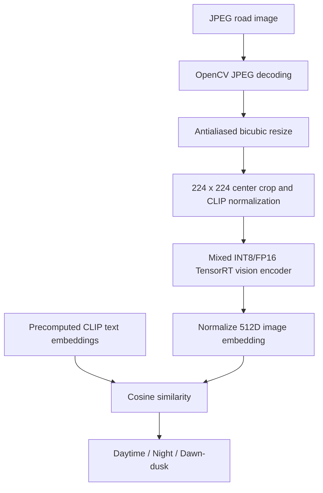

# CLIP Vision Encoder Optimization and C++ TensorRT Deployment

A GPU-accelerated road-scene time-of-day classifier built using
OpenAI CLIP ViT-B/16, NVIDIA ModelOpt, ONNX, TensorRT 11.4,
CUDA, and C++17.

## Task

Classify road images as:

- daytime
- night
- dawn/dusk

Classification uses cosine similarity between the CLIP vision
encoder's 512-dimensional output and three precomputed CLIP text
embeddings. This is fixed-prompt zero-shot classification, not
task-specific fine-tuning.

## Architecture



## Optimization

- Base model: `openai/clip-vit-base-patch16`.
- Selective INT8 quantization: attention projections, MLP fc1,
  and selected embedding operations.
- FP16: remaining compatible floating-point computation,
  including MLP fc2.
- FP32 model input and output interface.
- Calibration: 300 balanced training images, 100 per class.
- Evaluation: 300 separate balanced validation images.
- All 57,364,224 quantized weight values were preserved during
  FP16 conversion.
- TensorRT profile: batch sizes 1 through 32, optimal batch 8.

## Measured results

Hardware: NVIDIA Tesla T4. Engine-only GPU benchmarks exclude
JPEG decoding, CPU preprocessing, and model initialization.

| Metric | FP16 TensorRT | Mixed INT8/FP16 TensorRT |
|---|---:|---:|
| Engine size | 166.14 MiB | 114.42 MiB |
| Batch-1 mean GPU latency | 4.410 ms | 4.229 ms |
| Batch-32 mean GPU latency | 91.727 ms | 84.006 ms |
| Batch-32 throughput | 348.9 images/s | 380.9 images/s |
| Python evaluation accuracy | 80.67% | 81.33% |

The original FP32 PyTorch baseline achieved 81.00% accuracy
on the same 300-image validation subset.

### Standalone C++ application

- Accuracy: 80.67% (242/300).
- Macro F1: 0.7951.
- Agreement with original C++ implementation: 100%.
- Mean end-to-end latency: 33.77 ms/image.
- Median end-to-end latency: 32.56 ms/image.
- P95 end-to-end latency: 39.96 ms/image.

C++ application timing used images copied to local Colab storage,
one persistent engine instance, and sequential image processing.
Engine startup/deserialization was excluded.

The C++ preprocessing uses custom antialiased bicubic resizing
to closely approximate the CLIP image processor.

## Build requirements

- Linux, C++17 compiler, CUDA toolkit
- NVIDIA GPU supporting the serialized engine
- TensorRT 11.4 headers and runtime libraries
- OpenCV 4 C++ development libraries and pkg-config

TensorRT serialized engines are hardware- and
version-dependent. The engine was built for an NVIDIA
Tesla T4 under TensorRT 11.4; rebuilding from ONNX may be
necessary for other environments.

To build:

```bash
cd release
export TRT_INCLUDE_DIR=/path/to/TensorRT/include
export TRT_LIB_DIR=/path/to/TensorRT/lib
export CUDA_ROOT=/usr/local/cuda
./build.sh
```

Set the TensorRT locations to match the installed runtime.

## Run

```bash
./clip_classifier \
  /path/to/clip_attention_fc1_int8_fp16_repaired.engine \
  text_embeddings_fp32.bin \
  /path/to/example.jpg
```

You can provide multiple image paths in one invocation.
The application loads the engine once and emits CSV with
predictions, cosine similarity scores, and latency measurements.

Scores are cosine similarities, **not calibrated probabilities**.

## Limitations

- Evaluated on a relatively small, balanced 300-image subset.
- Dawn/dusk recall is materially lower than daytime and night.
- The C++ classifier achieved 80.67% accuracy versus 81.33%
  for the Python TensorRT inference pipeline; preprocessing
  differences can change predictions.
- CUDA-event engine-only benchmarks and C++ application timings
  are not directly comparable.
- CPU preprocessing remains the major end-to-end bottleneck.
- No claim of deployment across other GPUs or operating systems.
- This work demonstrates optimization and deployment of a
  pretrained model, not a newly trained classifier.

## Data and licensing

Road-scene data was sampled from
`dronefreak/BDD100K-Period-Classification`.
Observe the underlying BDD100K dataset terms before redistributing
images or derived datasets.

Respect the licenses and redistributability requirements of the
pretrained model, TensorRT components, CUDA, and OpenCV.

Do not publish downloaded dataset images, vendor headers,
pretrained weights, or serialized model artifacts without
reviewing the relevant terms.

## Reproducibility

Evaluation manifests and individual benchmark results are stored
in the parent project's `data/` and `results/` folders.

The complete calibrated checkpoint, ONNX graphs, and TensorRT
engines are stored under `phase2_artifacts/`.

To reproduce this specific engine build, use the saved
quantized ONNX graph and the documented TensorRT 11.4 profile.
Exact engine bytes and latency may change with hardware,
driver, runtime version, and builder tactic selection.
